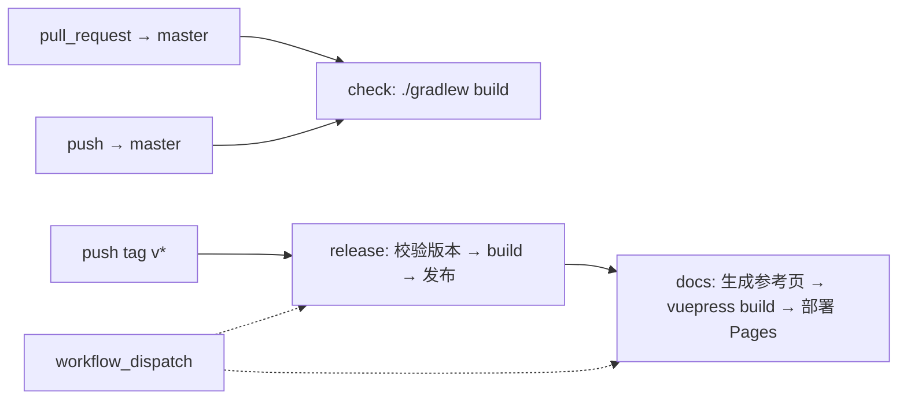

# Ixchel UI: CI Workflows

## Summary

现在只落地 `check`：PR 与 `master` 推送跑全量 `./gradlew build`，仅 Linux，设为 `master` 的 required check；`setup-gradle` 缓存 Gradle User Home，只由 `master` 写入。`release`（`v*` tag 触发，版本以 `gradle.properties` 为准）与 `docs`（VuePress 站，随 release 部署到本仓库 GitHub Pages）只定触发与校验规则，等有外部宿主、L1+ 文档生成落地、仓库转公开后再实现；远端发布目标届时再定。安全上 `check` 不用 secret、token 只读；改动 `.github/workflows/` 的 PR，检查结果不可信，必须看 diff。

## Detail

### 1. 仓库约束

| 项 | 现状（2026-10-26） | 对 CI 的影响 |
|---|---|---|
| 可见性 | 早期开发期私有，后续转公开 | 私有期间 Actions 按分钟计费（Windows 按 2 倍计）、Pages 需付费套餐、fork PR 默认不运行 workflow；转公开后分钟与 Pages 免费 |
| 合入 | ruleset `master`（作用于默认分支）：禁止删除与强推、线性历史、必须走 PR 且只允许 squash、0 个必需 approve，必需检查 `build`（GitHub Actions）且要求分支与 `master` 同步；无 bypass；维护者只有一人 | `check` 的 job 名 `build` 即必需检查的 context，改 job 名须同步改 ruleset。注意：旧版分支保护接口（`branches/master/protection`）看不到 ruleset，查规则用 `rules/branches/master` |
| 发布 | `ixchel.library` 已配 `maven-publish`；不发 Maven Central，开发期 `publishToMavenLocal` | 暂无远端仓库 |
| 版本 | `gradle.properties` 中 `version=0.1.0-SNAPSHOT` | 发版版本以此为准（#010） |
| 构建 | 已开 Gradle build cache 与 configuration cache；mc/loader/testmod 用 MDG（legacyforge / NeoForm）；toolchain 由 foojay 插件兜底下载 | 首次构建要下载并反编译 MC，须缓存 Gradle User Home |
| 本地耗时 | `:ixchel-core:test` 约 182 s（含 Gradle 启动与配置） | 无缓存时 PR 检查为分钟级（推断） |

### 2. 流程与触发器



| 流程 | 状态 | 触发 | 内容 |
|---|---|---|---|
| `check` | 现在实现 | `pull_request`（目标 `master`）、`push: master` | 见 §3 |
| `release` | 规则已定，暂不实现 | `push` tag `v*`；保留 `workflow_dispatch` | tag 去掉 `v` 后须等于 `gradle.properties` 的 `version` 且不含 `-SNAPSHOT`，否则失败；通过后 `build` 再发布 |
| `docs` | 规则已定，暂不实现 | `release` 成功后；保留 `workflow_dispatch` | VuePress 源码在本仓库 `docs/`；先由 Gradle 任务从属性注册表与元素注册表生成参考页，再 `vuepress build`，用 `actions/deploy-pages` 部署到本仓库 Pages |

取舍：

- `check` 始终全量，不按路径过滤：required check 一旦被路径过滤跳过，PR 会一直停在等待状态；全量的成本靠缓存摊薄。
- `push: master` 也跑：squash 后的提交与 PR 头提交不是同一个提交，跑一次确认合入后的结果；它同时是缓存的唯一写入方（§4）。
- 只用 Linux：core 读写文本都显式写 `StandardCharsets.UTF_8`（CONVENTIONS），GBK 默认字符集的回归靠代码约定兜住，不为它付 2 倍分钟数。
- 文档站跟随 release 而不是 `master`：站点描述的应是宿主实际 shade 进去的版本。
- 文档站不另开仓库：参考页由代码生成，手写文档也应与代码在同一 PR 里改；同仓库部署 Pages 只需 workflow 的 `pages: write` 权限，不需要跨仓库 token。只有在"代码私有而文档必须先公开"或文档另有维护者时才值得拆仓库，转公开后这两种情况都不存在。
- 不用 GitHub wiki：wiki 只渲染 Markdown，没有 VuePress 的导航、搜索与自定义组件，CI 推送还要单独的 wiki 仓库权限。

### 3. `check` 的组成

`./gradlew build` = `assemble` + `check`，在本仓库展开为：

| 阶段 | 项目 | 内容 | 能拦下的问题 |
|---|---|---|---|
| toolchain | 全部 | 解析 JDK 17 与 21（CI 中直接用 `setup-java` 装好的，实测无 foojay 下载） | — |
| MC 产物 | mc、loader、testmod 共 6 个 | MDG `createMinecraftArtifacts`：下载、反混淆、反编译（不重编译 MC） | 版本号错、上游不可达 |
| 编译 | 全部 7 个 | `compileJava` | 编译错误；core 引用 MC 类（编译期 classpath 没有 MC） |
| 打包 | 5 个库 | `jar`、`sourcesJar`、`javadocJar`；1.20.1 两个库的 `jar` 自动 reobf 为 SRG | **javadoc 的 doclint 错误**（`withJavadocJar()` 使 javadoc 成为隐含检查） |
| 打包 | 2 个 testmod | `jar`（Forge 侧也 reobf） | — |
| 测试 | core | JUnit，含弹药 HUD 黄金测试 | 行为回归 |

`build` 不包含：`runClient`、gametest、格式化与静态分析（仓库未配）、shade 产物验证。

workflow 骨架（实际文件 `.github/workflows/check.yml`）：

```yaml
on:
  pull_request: { branches: [master] }
  push: { branches: [master] }
concurrency:
  group: check-${{ github.ref }}
  cancel-in-progress: ${{ github.event_name == 'pull_request' }}
permissions: { contents: read }

jobs:
  build:
    runs-on: ubuntu-latest
    timeout-minutes: 20          # 冷构建实测 4~5 分钟
    steps:
      - uses: actions/checkout@v7
      - uses: actions/setup-java@v6
        with: { distribution: temurin, java-version: "17\n21" }
      - uses: gradle/actions/setup-gradle@v5   # 不升 v6，见 §4
      - run: ./gradlew build
      - if: failure()
        uses: actions/upload-artifact@v7
        with: { name: reports, path: "**/build/reports/" }
```

| 设计点 | 理由 |
|---|---|
| `concurrency` 只对 PR 取消旧运行 | `master` 上若取消，前一个合入提交既没跑完检查也没写缓存；PR 上新提交使旧结果无意义 |
| `permissions: contents: read` | `check` 不需要写权限；同时限定被篡改的 workflow 能拿到的东西（§5） |
| `setup-java` 装 17/21 而不靠 foojay | 用 runner 工具缓存中的预装 Temurin（实测 setup 约 1 s），不依赖 foojay 网络、不占 Gradle 缓存；Gradle 9 自身需要 17+ 的 JVM 启动。Gradle 无需 `installations.fromEnv` 也能找到这两个 JDK（实测） |
| action 主版本 | 均为 Node 24 版本；v4 系列在首次运行中报 Node 20 弃用告警，`setup-java@v4` 另报已弃用 |
| 失败时上传报告 | 黄金测试失败时可下载 HTML 报告看实际与期望 DisplayList 的差异；成功时不上传，不占时间 |

### 4. 缓存

`gradle/actions/setup-gradle@v5` 把 Gradle User Home 存入 GitHub Actions cache。停在 v5：v6 起缓存功能拆成闭源组件 `gradle-actions-caching`，使用即接受 Gradle Terms of Use；v5 为 MIT，最后一次发布 v5.0.2（2026-02），之后需要新功能或修复时再在 v6 与 `actions/cache` 自管之间选择。

| 内容 | 位置 | 作用 |
|---|---|---|
| 依赖 jar（taffy、junit、MC 库、Forge/NeoForge） | `caches/modules-2` | 免重复下载 |
| MC 反编译与重映射产物 | `caches/neoformruntime`（NFRT 缓存，legacyforge 与 NeoForm 共用） | 免两个 MC 版本重复反编译，最耗时的一步 |
| 任务输出 | `caches/build-cache-1`（仓库已开 `org.gradle.caching=true`） | 未变模块不重编译、不重跑测试 |
| Gradle 发行包、toolchain | `wrapper/dists`、`jdks` | 免重复下载 |

本机全量 `build` 后实测（2026-10-26，本机 Gradle User Home 与其它项目共用，`modules-2` 等偏大）：`neoformruntime` 1.5 GiB、`modules-2` 0.8 GiB、`caches/9.2.1`（transforms 等）1.1 GiB、`jdks` 1.0 GiB、`wrapper` 0.3 GiB。CI 上首个 `master` 运行写入的缓存（压缩后）：`setup-gradle` 拆成 8 条，合计约 1.0 GiB（主条目 `gradle-home` 455 MiB、依赖 332 MiB、wrapper 128 MiB、transforms 65 MiB、其余 < 40 MiB），10 GB 配额够用。

规则：

- 键由 job、OS 与构建脚本哈希组成；改 `libs.versions.toml`（如升 MC/Forge 版本）生成新条目（推断）。
- 只有默认分支写缓存，PR 只读 `master` 的缓存（`setup-gradle` 默认行为）；PR 写的缓存只对该 PR 可见，不让 PR 写可避免各 PR 各存一份占满配额。
- 配额每仓库 10 GB，7 天未访问的条目被清除；`master` 7 天无合入后的首次运行回到冷构建。
- configuration cache 不进 CI 缓存：持久化需要加密密钥 secret，收益小。

### 5. 安全

前提：`pull_request` 触发时，workflow 文件与构建脚本都取自 PR 本身，PR 作者可以任意修改，`build.gradle.kts` 本身就能执行任意代码。workflow 里的检查步骤防不住改动者，防护来自平台与权限设计。

| 改动者 | 改动的作用范围 | 能拿到的 | 最坏结果 |
|---|---|---|---|
| 外部贡献者（fork PR） | 只在该 PR 的运行中生效，经批准后才运行 | 只读 token，无 secret | 消耗 runner 时长；**把 `./gradlew build` 换成 `true`，伪造通过的 required check** |
| 有写权限的协作者（同仓库分支） | 其分支的 `push` 与 PR 运行 | secret 与可写 token | 窃取 secret、篡改仓库 |
| 任何人，PR 被合入 | 成为之后所有运行用的 workflow | 合入后各触发方式的全部权限 | 恶意 `release.yml` 获得发布权限 |

GitHub 的平台防护：fork PR 不传 secret、token 只读、不能修改 `.github/workflows/`；`GITHUB_TOKEN` 永远不能写 workflow 文件，PAT 与 GitHub App 需单独的 `workflow` 权限；PR 写的缓存 `master` 读不到；托管 runner 每个 job 一台新虚拟机，用后销毁。

规则：

- 改动 `.github/workflows/` 的 PR，其检查结果不可信，必须看 diff；构建相关文件（`gradle/wrapper/`、`build-logic/`、`settings.gradle.kts`）同理。
- 不使用 `pull_request_target`：它用目标分支的 workflow，但能拿到 secret 与可写 token；在其中 checkout 并执行 PR 代码即把仓库权限交给 PR 作者。若日后为打标签、评论引入，不 checkout、不执行 PR 代码，PR 标题等文本经 `env:` 引用，不直接插入 `run:`。
- 公开仓库不使用 self-hosted runner。

分阶段措施：

| 措施 | 防的是什么 | 时机 |
|---|---|---|
| `check` 不用 secret、`permissions: contents: read` | 被篡改的 workflow 拿到的东西没有价值 | 现在（§3 骨架已含） |
| fork PR 运行审批设为"所有外部协作者" | 时长滥用；运行前能先看 diff | 转公开时 |
| Actions 只允许 GitHub 官方与经认证的 action | 第三方 action 被投毒（如 2025-03 `tj-actions/changed-files` 的 tag 被篡改） | 转公开时 |
| 发布 secret 放入 GitHub Environment `release`，限定 `v*` tag 才能使用 | 分支上被改的 workflow 拿不到发布凭据 | 实现 `release` 时 |
| ruleset 限制谁能创建 `v*` tag | 他人打 tag 触发发版 | 实现 `release` 时 |
| `release`、`docs` 中的 action 用 commit SHA 固定 | tag 可被改指；这两个流程持有写权限与 Pages 部署权限 | 实现时；`check` 只读，用版本 tag |
| CODEOWNERS（`/.github/`、`/gradle/wrapper/`、`/build-logic/`、`/settings.gradle.kts`）+ ruleset 要求 Code Owner 批准 | 协作者改动关键文件未经所有者审核 | 有第二个维护者后；单人时自己的 PR 无法自批，只会每次 bypass |
| push ruleset 限制文件路径 | 在推送时拒绝修改关键路径的提交（覆盖所有分支） | 有协作者后；个人账户公开仓库可否使用待核实 |

### 6. 发版流程（实现时）

1. 分支上把 `gradle.properties` 改为正式版本，经 PR squash 合入。
2. 在合入提交上打 `v<version>` tag 并推送，`release` 校验后发布。
3. 再提一个 PR，把版本改回下一个 `-SNAPSHOT`。

发布目标未定：宿主 shade 需要 Gradle 能解析的 Maven 仓库，候选是 GitHub Packages（私有仓库下消费方也要带 PAT 才能拉取）。等第一个外部宿主（TACZ-RESPAWN）需要拉取时再定。

### 7. 暂不进 CI

| 项 | 原因 | 何时加 |
|---|---|---|
| `runClient` 游戏内冒烟、Iris/ImmediatelyFast 共存 | 需要 GPU 与图形界面；M2 退出条件按手动验证 | 不计划 |
| shade 双副本共存 | M4 前没有 shade 配方 | M4 作为 `check` 内的一个 Gradle 任务加入，不另开流程 |
| 定时构建 | 没有会悄悄变化的外部依赖 | 出现时再加 |
| Windows runner | 见 §2 取舍 | 出现实际的字符集回归时再加；转公开后分钟数不再计费，可重新评估 |
| 文档站部署 | 私有期间 Pages 需付费套餐，且站点本身会公开 | 仓库转公开后 |
| PR 标题格式检查 | squash 用 PR 标题作提交信息，但单人维护下没有出现过不合格的标题 | 有外部贡献后 |
| `vuepress build` 进 `check` | `docs/` 尚不存在 | `docs/` 建立时 |

### 8. 实测与待核实

- 冷构建实测（2026-10-26，PR #5 两次运行，均无缓存）：`./gradlew build` 5m03s 与 4m08s，44 个任务全部执行；`timeout-minutes` 定为 20。
- 已确认：无 foojay 下载；`setup-gradle` 默认开启 wrapper 校验（日志 "All Gradle Wrapper jars are valid"）；PR 运行时缓存为只读（"Cache is read-only"），缓存从合入 `master` 后的首次运行开始写入。
- 首个 `master` 运行（PR #5 合入后）：`./gradlew build` 4m40s，缓存写入约 12 s。PR #6 命中该缓存：恢复约 18 s，`./gradlew build` 38 s（44 个任务中 12 个取自 build cache），整个 job 69 s。待确认：私有期间每月 Actions 分钟数是否够用。
- javadoc doclint 改为 `all,-missing`（2026-10-26 定）：保留语法类检查，去掉约 100 条"缺注释"告警，PR 上不再出现对应 annotation。
- 转公开后：Pages 来源设为 GitHub Actions，VuePress 的 `base` 设为 `/IxchelUI/`（使用 `<user>.github.io/<repo>` 路径时）；确认 push ruleset 对个人账户公开仓库是否可用。
