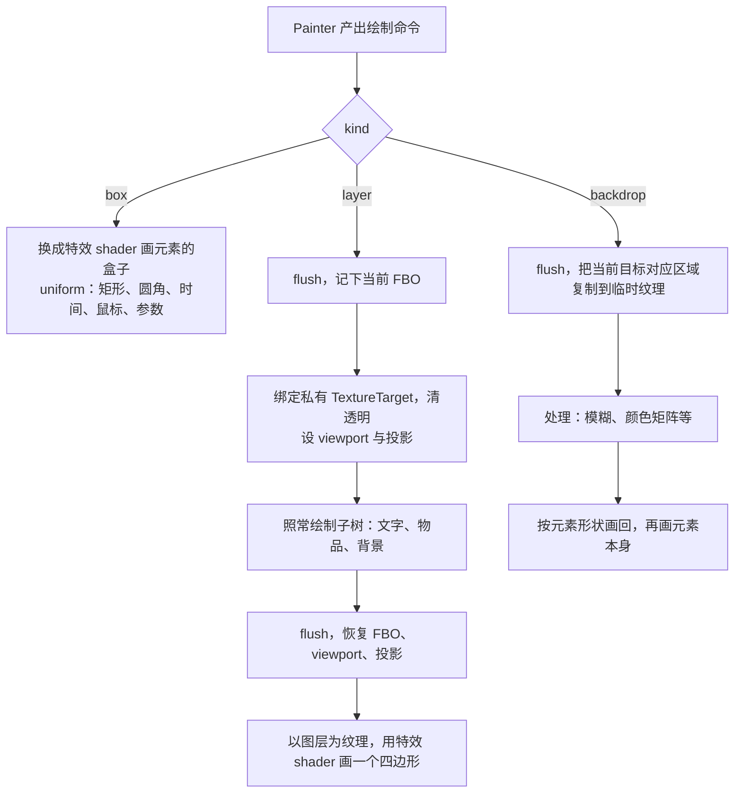

# Ixchel UI 特效

## Summary

特效是一个 `.effect` 资源文件：`kind`（`box`/`layer`/`backdrop`）、类型化 `param` 与一个 GLSL `effect()` 函数，函数用库内原语库（SDF、噪声、颜色矩阵、混合等）组合而成。文档用 `<link rel="effect">` 按资源路径引入；`box` 类写 `background-image: paint(名)`，`layer` 类写 `filter: -ix-paint(名)`，参数是自定义属性 `--名-参数`。底座是私有图层与 shader 注册，均不需要 mixin；UI 在光影最终输出之后绘制，不与光影冲突。

## Detail

### 1. 参照系

**MC 与光影**

- 原版 1.21.1 自己就在 GUI 阶段对主画面做后处理：`Screen.renderBlurredBackground` → `GameRenderer.processBlurEffect`，跑 `shaders/post/blur.json`。
- Iris 用 mixin 改写 `GameRenderer.getPositionColorShader` 等方法，条件是 `shouldOverrideShaders()` = `isRenderingWorld && isMainBound`；`finalizeLevelRendering()` 先置 `isRenderingWorld = false`，再跑合成与最终输出（Iris 1.20.3 分支 `IrisRenderingPipeline`）。画 UI 时原版 GUI 着色器已还给原版，库自己的 `ShaderInstance` 不在替换列表里。Forge 1.20.1 的 Oculus 是 Iris 移植，未核对源码。
- 在画世界期间画 UI（世界空间 UI）时 Iris 会接管，见 §8。

**同类库**（均为 LGPL，只参考思路，不拷代码与 shader）

| 库 | 做法 |
|---|---|
| AUI | `render/FilterRenderer`：FBO 栈与池、`filter`/`backdrop-filter`（降采样 + 两遍模糊）、`mix-blend-mode` 17 种（离屏 + 背景快照）、`mask-image`；进出离屏前提交所有批处理，含 `Font.drawInBatch` 的共享缓冲 |
| LDLib2 | `ShaderTexture`：按 `ResourceLocation` 引用用户 shader，在一个四边形上画，传 `U_GuiRect`、`U_GuiMouse`；`OffscreenSurface`（`TextureTarget`）、`UIVisualLayer`（MainTarget 池） |

两者都没有针对光影的特殊处理（LDLib2 的 `isIrisLoaded()` 无调用方），这只说明没有特殊代码，不是兼容性证明。

**Web**

- 标准能覆盖的：`filter`（颜色矩阵类函数、`blur`、`drop-shadow`）、`backdrop-filter`、`mix-blend-mode`、`mask-image`、渐变（`linear`/`radial`/`conic`）。Web 上的流光边框常用 `conic-gradient` 边框 + `mask` 挖空 + `@property` 注册角度后做动画，不写 shader。
- 自定义绘制：CSS Painting API，`background-image: paint(名)`，名字由文档注册的 worklet 提供，参数经 `inputProperties`（自定义属性）读取。
- CSS Shaders 的 `filter: custom()` 已废弃，子树级自定义效果没有标准写法。

### 2. 原语与常见组合

绝大多数 UI 特效由少数基础操作组合而成。输入只有几种：元素内位置（像素与 UV）、元素矩形与圆角、时间、鼠标、纹理（内容图层、背景快照、噪声图）、用户参数。

**原语**

| 原语 | 做的事 | 典型用途 |
|---|---|---|
| SDF | 到形状（圆角矩形、圆、环、线段）边缘的有符号距离 | 抗锯齿圆角、描边、外发光、软阴影、进度环 |
| 遮罩 / 阈值 | `step`/`smoothstep` 把值切成可见与不可见，窄带取边缘 | 溶解、擦除过渡、裁剪 |
| UV 变换 | 平移、缩放、旋转、量化、扭曲、极坐标 | 流动、波纹、马赛克、CRT 曲面、径向进度 |
| 噪声 | value、Perlin/simplex、fbm、Voronoi，2D 或带时间 | 溶解形状、颗粒、闪烁、能量纹理 |
| 颜色映射 | 颜色矩阵（灰度、复古、色相、饱和度、对比度、亮度、反相）、渐变映射 / LUT | 黑白、复古、镭射彩虹、受击变色 |
| 卷积 / 模糊 | 高斯、Kawase、降采样 | 毛玻璃、bloom、阴影 |
| 通道分离 | R、G、B 分别偏移采样 | 色差、故障 |
| 周期函数 | `sin`、`fract`、三角波、脉冲 | 扫描线、呼吸、闪光扫过 |
| 混合 | 正常、叠加（add）、正片叠底、滤色、覆盖 | 发光叠加、全息覆盖层 |

**常见组合**

| 效果 | kind | 组合 | 标准 CSS 能否表达 |
|---|---|---|---|
| 边缘流光 | box | SDF 边缘窄带 × 沿周长随时间移动的亮段（极坐标或周长相位 + 时间）→ 叠加 | 能（`conic-gradient` + `mask` + 动画），需先有这些原语 |
| 扫光（斜向高光扫过） | box | 斜向 UV 上移动的窄带 → 叠加 | 能（`linear-gradient` + 动画 `background-position`） |
| 镭射 / 全息 | box | UV 加鼠标偏移 → 彩虹渐变映射 + 噪声扰动 → 滤色或覆盖 | 不能（缺噪声） |
| 外发光 / 内发光 | box | SDF 衰减 → 叠加 | 部分（`box-shadow`、`drop-shadow`） |
| 能量 / 液体填充 | box | 噪声 + 时间扰动的阈值线 → 颜色映射 | 不能 |
| 进度环 / 冷却遮罩 | box | 极坐标角度 → 阈值 | 能（`conic-gradient`） |
| 呼吸 / 闪烁提示 | box 或 layer | 颜色映射 × 周期函数 | 能（`opacity`/`filter` 过渡或动画） |
| 溶解 | layer | 噪声 → 阈值（进度）→ 阈值附近窄带染边缘色 | 不能 |
| 黑白 | layer | 颜色矩阵 | 能（`filter: grayscale()`） |
| 复古 | layer | 颜色矩阵 | 能（`sepia()`、`contrast()`） |
| 胶片 | layer | 颜色矩阵 + 随时间变化的颗粒噪声 + 暗角 + 偶发划痕（UV 条纹） | 只有调色部分 |
| 电子屏 CRT | layer | UV 曲面扭曲 → 通道分离 → 扫描线（`sin(y)`）→ 暗角 → 少量噪声 | 不能 |
| 故障（glitch） | layer | 按时间分段的 UV 横向错位 + 通道分离 | 不能 |
| 像素化 / 马赛克 | layer | UV 量化 | 不能 |
| 受击闪色 | layer | 颜色映射（向目标色混合）× 时间 | 部分（`filter` 过渡） |
| 毛玻璃 | backdrop | 背景快照 → 降采样模糊 → 叠底色 → 少量噪声防色带 | 能（`backdrop-filter`） |
| 背后黑白 / 变暗 | backdrop | 背景快照 → 颜色矩阵 | 能（`backdrop-filter`） |
| bloom | layer | 阈值提亮 → 模糊 → 叠加回去 | 不能 |

标准 CSS 拼不出的部分，缺的主要是噪声与 UV 扭曲两类原语，这部分由 `.effect` 提供。

### 3. 三种机制



- `box`：不需要离屏。现在 `McPainter` 只用原版 `position_color`/`position_color_tex`，改为设特效的 `ShaderInstance` 并填 uniform。
- `layer`：Painter 与原生元素的绘制代码不变，它们画到当前绑定的帧缓冲上。嵌套用栈。同一机制给出 `opacity` 的整组语义：现在 `opacity` 逐次乘 alpha，子元素重叠处互相混合，原生元素不淡出（`Painter` 类注释）。图层带深度缓冲，物品与实体在图层内照常做深度测试。图层按屏幕空间开在 transform 之外，子树带 transform 画入、合成时贴回原位（路线图 FX1 已定）。
- `backdrop`：只读当前目标（主画面或父图层），不写它的状态。

### 4. MC 约束与做法

- 源码从包路径读取：`ShaderInstance(ResourceProvider, String, VertexFormat)` 读 json、vsh、fsh 与 `#moj_import` 都经传入的 provider，1.20.1 与 1.21.1 签名相同；库用自己的 classpath provider，源码随 relocate 迁移，不需要固定 namespace 的 `assets/`（#001）。
- 程序名带宿主 modid 前缀：`ShaderInstance.getOrCreate` 按名字查 `Program.Type.getPrograms()` 这张全局静态表，同名直接复用。两个宿主各 shade 不同版本的库时，同名会拿到对方编译的程序。库自带 shader 名为 `<宿主modid>_ixchel_<名>`，`.effect` 为 `<宿主modid>_fx_<路径>`。
- 资源重载：`GameRenderer.reloadShaders` 只关闭原版自己 `shaders` 表里的实例，库构造的程序不受影响（实测，#033）。库自带 shader 不注册、不重建；`.effect` 由库的重载监听先 `close()` 旧实例再清缓存，否则同名重建会从全局表拿回旧程序。
- 不用 `EffectInstance`/`PostChain`：它们只经 `ResourceManager` 读 `shaders/program`、`shaders/post`、`textures/effect` 这些固定资源路径。
- 噪声图等纹理用 `DynamicTexture` 的原始 id，或以宿主 modid 注册。
- GL 状态（前三条与最后两条是 CONVENTIONS「渲染」「嵌入边界」已有规则）：切换 FBO 或着色器前 `flush()`，这也是与 ImmediatelyFast 合批共存的前提；FBO 绑定走 `GlStateManager`/`RenderTarget.bindWrite`，否则原版与 Iris 的绑定缓存不同步；恢复进入前绑定的 FBO，而不是固定回主画面；viewport、投影矩阵、scissor（坐标换算到图层）、混合、深度测试在进出图层时保存并恢复；FBO 惰性分配、帧内按尺寸复用、用完释放；不用主画面模板缓冲。
- 不需要 mixin（#002）。

### 5. 定义格式

一个特效一个 `.effect` 文件，放在宿主 UI 资源中，与模板、组件同处；名字取文件名。

```glsl
// effects/glint.effect —— 边缘流光
kind box;
param color  <color>  = #ffffffcc;
param speed  <number> = 0.5;       // 圈/秒
param width  <length> = 2px;

vec4 effect(IxBox b) {
    float d     = ix_sd_round_rect(b.pos, b.size, b.radius);
    float band  = 1.0 - smoothstep(0.0, width, abs(d));
    float phase = fract(ix_perimeter(b) - ix_time * speed);
    return color * band * ix_pulse(phase, 0.15);
}
```

```glsl
// effects/dissolve.effect —— 整块溶解
kind layer;
param progress   <number> = 0;
param edge-color <color>  = #ff8a00;
param edge       <length> = 3px;

vec4 effect(IxLayer l) {
    vec4  c   = ix_content(l.uv);
    float cut = ix_fbm(l.pos / 24.0) - progress;
    float e   = 1.0 - smoothstep(0.0, edge / 24.0, cut);
    return cut < 0.0 ? vec4(0) : mix(c, edge_color * c.a, e);
}
```

- `kind` 决定可用的位置与输入：`box` 拿到 `IxBox`（元素内像素位置、尺寸、四角圆角）；`layer` 另有 `ix_content(uv)`；`backdrop` 另有 `ix_backdrop(uv)`。三者都有 `ix_time`、`ix_mouse`。
- `param` 的类型取 CSS 值类型：`<number>`、`<length>`、`<percentage>`、`<color>`、`<angle>`、`<time>`。库生成 uniform：长度按 GUI 缩放换算为像素，颜色转 vec4，角度转弧度；参数名中的 `-` 在 GLSL 中写作 `_`。
- 库把 `effect()` 包成完整的 fsh/vsh/json 并引入原语库；作者只写组合。
- 圆角取自 `border-radius`（V1 已支持）。
- 内置特效用同一格式写，随库发布，从 `@ixchel/effects/…` 引入，与 `LibrarySheets` 的 `@ixchel/` 命名一致；内置与用户特效没有区别。资源包可按同一资源 id 覆盖特效文件来换皮。

### 6. 使用

```html
<link rel="effect" href="effects/glint"/>
<link rel="effect" href="effects/dissolve"/>
<div class="card">…</div>
```

```css
.card {
  background-image: paint(glint);
  --glint-color: var(--ix-accent);
  --glint-speed: 0.3;
}
.card:hover { --glint-speed: 1.5; }

.panel.fading {
  filter: grayscale(.5) -ix-paint(dissolve);
  --dissolve-progress: 1;
  transition: --dissolve-progress .6s ease-in;
}
```

- `<link rel="effect">` 与 `<link rel="component">` 同规则：写在第一个元素之前，作用域为当前文档，没有全局注册表（#015）。
- 参数是自定义属性 `--<特效名>-<参数名>`，前缀避免同一元素上两个特效的参数撞名。参数因此走层叠、`var()`（主题变量 #018）、伪类，以及 Java 侧的 `bind:style:--x`；因为带类型，相当于自动做了 `@property` 注册，可以 `transition`。未设置的参数取默认值。
- `box` 类出现在 `background-image` 的图层列表中，可与图片、其它 `paint()` 叠用；`layer` 类出现在 `filter` 链中，与标准 filter 函数按书写顺序串联；`backdrop` 类出现在 `backdrop-filter` 中。
- 开发期检查（#003、#023，码前缀 `effect/`）：未引入的特效名、`kind` 与所在属性不符、未声明的参数、参数值不合类型。CSS 一侧由 `ixchelLint` 报出；GLSL 只能在游戏内编译，编译错误在加载期报出，行号映射回 `.effect` 文件。改动 `.effect` 后资源重载即生效。

### 7. 已否决

| 方案 | 原因 |
|---|---|
| 位置参数 `paint(名, 参数…)` | 不能单独覆盖某个参数，函数参数不能过渡，要记住顺序；与自定义属性并存时须规定两个来源的优先级 |
| 包裹元素 `<ix-effect name>` | 特效是绘制方式，属于样式；包裹会改模板结构、多一层 DOM，不能与标准 `filter` 串链。#020 选库元素是因为 tooltip 本身是一棵有独立内容与顶层定位的子树 |
| 运行时节点图 / 万能 shader / 动态拼接 GLSL | 调试难、编译缓存难管，没有需求支撑 |
| JSON 声明 + GLSL 两个文件 | 作者同步维护两处 |
| 全局特效注册表 | 多宿主、多副本下撞名（同 #015） |
| `EffectInstance`/`PostChain` | 只读固定资源路径（§4） |

### 8. 未解决

- 光影与渲染 mod 实测：Oculus、OptiFine 未验证。验收方式是在生产实例装 Oculus + 光影包 + ImmediatelyFast + Embeddium，用 playtest 截图与不装时对比。
- 版本前瞻（未核对源码）：1.21.2 起 shader 改由 `ShaderManager` 从资源包加载，1.21.5 起为 `RenderPipeline`，1.21.6 起 GUI 延迟渲染并经 PIP 渲染到纹理，自定义 provider 可能走不通。退路是 Gradle 插件在 shade 时把库 shader 复制到宿主 jar 的 `assets/<宿主modid>/shaders/`，namespace 仍归宿主。
- 世界空间 UI：目前没有世界空间宿主（场景文档 §5 只记录不排期），`WorldProjection` 只换算坐标、仍在 HUD 中绘制。若将来在画世界期间画 UI，Iris 会接管原版着色器与主画面绑定，需单独评估。
- HUD 帧开销：每个 `layer` 特效每帧多一次离屏绘制与一次合成。子树未变脏时可缓存图层、只重跑合成；可行性取决于 core 的脏标记粒度，未核对。
